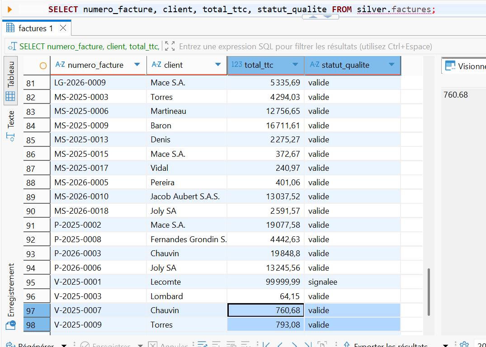
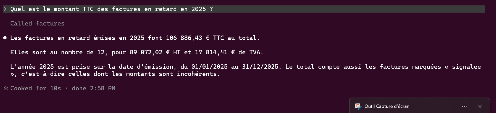

# De la facture scannée à l'agent IA

<p style="text-align:center">Clément Frassier — DAMS5 — Novembre 2026</p>

## 1. Architecture et choix techniques

L'objectif du projet est de traiter automatiquement 100 factures fournisseurs stockées sur S3, dont la moitié sont des scans sans texte, puis de pouvoir les interroger en langage naturel. La chaîne mise en place est la suivante :

```
PDF (S3 "factures") -> détection texte/image -> couche texte  ou  OCR LightOnOCR-3
  -> BRONZE (texte brut + traçabilité, Parquet S3) -> SILVER (tables typées + quarantaine, Parquet S3)
  -> entrepôt DuckDB (vues SQL) -> serveur MCP (lecture seule) -> agent IA (LLM au choix)
```

Le projet est écrit en Python 3.12, le langage qui offre le plus de bibliothèques pour la donnée et l'IA. Les dépendances sont gérées avec `uv`, qui installe Python et des versions verrouillées en une seule commande, ce qui simplifie le lancement pour un nouvel arrivant. Les données sont stockées en Parquet sur les buckets S3 d'Hyperfluid : c'est un format en colonnes, typé, que les moteurs SQL savent lire directement. L'accès au stockage se fait avec `boto3`, qui fonctionne avec n'importe quel service compatible S3. Les PDF sont lus avec PyMuPDF, qui permet à la fois d'extraire la couche texte et de convertir une page en image pour l'OCR.

Le modèle d'OCR et les LLM utilisés exposent tous une API compatible OpenAI. Nous les appelons donc avec le SDK `openai` standard, l'adresse, la clé et le nom du modèle étant lus dans la configuration. L'entrepôt repose sur DuckDB, un moteur SQL sans serveur capable de lire le Parquet directement sur S3, et le serveur MCP sur le SDK officiel `mcp`. Enfin, tous les secrets sont placés dans un fichier `.env` exclu de Git ; seul un modèle sans valeurs (`.env.example`) est versionné. Comme une clé S3 Hyperfluid ne donne accès qu'à un seul bucket, nous avons une clé par bucket, chacune avec les droits minimum nécessaires.

## 2. Réalisation, étape par étape

### Étape 1 — Récupérer les factures

La commande `factures fetch` télécharge les PDF du bucket dans une zone d'arrivée locale. Pour ne récupérer que les nouvelles factures, un manifeste conserve l'ETag S3 (l'empreinte du fichier) de chaque objet déjà téléchargé : au second lancement, aucun fichier n'est retéléchargé.

La commande `factures detect` détermine ensuite si chaque PDF possède une couche texte. Elle extrait le texte avec PyMuPDF et compte les lettres et les chiffres : en dessous de 30, le document est considéré comme une image à passer à l'OCR. Nous obtenons 50 PDF texte, qui contiennent entre 552 et 718 caractères, et 50 PDF image, qui n'en contiennent aucun. L'écart est assez net pour que le seuil ne pose aucune ambiguïté. Les noms de fichiers indiquent `_texte` ou `_scan`, mais nous ne les avons utilisés que pour vérifier le résultat, avec aucune erreur.

### Étape 2 — Appeler le modèle d'OCR

La commande `factures ocr` envoie une page au modèle LightOnOCR-3 et affiche le texte reconnu ainsi que le temps de traitement, d'environ 7 à 8 secondes par page.

La fiche du modèle précise le format attendu : une seule image PNG par requête, encodée en base64, sans instruction textuelle, avec un côté le plus long de 1540 pixels et une température basse. Une autre instruction sortirait du cadre dans lequel le modèle a été entraîné. Le texte renvoyé est du Markdown, avec les tableaux en HTML, et sa mise en forme varie d'un appel à l'autre (le gras n'est pas toujours présent), ce qui a compté pour l'écriture du parseur. Une image plus petite est traitée plus vite (6 secondes à 768 pixels contre 10 secondes à 2500 pixels), mais elle est plus floue ; nous avons mesuré l'effet sur la qualité à l'étape 5.

Le code n'utilise que l'API standard OpenAI : pour changer de fournisseur d'OCR, il suffit de modifier trois variables du `.env`. La clé d'API se trouve uniquement dans ce fichier.

### Étape 3 — Couche bronze

La couche bronze conserve, pour chaque PDF, le texte brut tel qu'il a été extrait, par la couche texte ou par l'OCR. La commande `factures bronze` ajoute à chaque lancement un nouveau fichier Parquet dans le bucket `default-bronze`.

Pour savoir si un fichier a déjà été traité, le nom ne suffit pas, car un fichier peut être renommé et deux fichiers différents peuvent porter le même nom. Nous utilisons donc l'empreinte SHA-256 de son contenu : un document déjà ingéré avec succès n'est jamais retraité. Chaque ligne garde aussi l'emplacement S3 d'origine, le type de PDF, la méthode d'extraction, le modèle et la résolution utilisés, la durée, le statut et la date, ce qui permet de retrouver l'origine de toute valeur.

La couche bronze n'est jamais modifiée ni supprimée, parce qu'elle est la seule copie fidèle de l'extraction : en cas d'erreur dans le traitement suivant, on peut tout reconstruire sans refaire l'OCR, qui est lent et payant. La clé S3 de ce bucket n'a d'ailleurs pas le droit de supprimer de fichier. Pour vérifier les critères, nous avons coupé volontairement l'OCR : le pipeline n'a pas planté, les 50 scans ont été enregistrés en erreur, puis retraités au lancement suivant. Un troisième lancement n'a rien ajouté et n'a fait aucun appel à l'OCR.

### Étape 4 — Couche silver

La commande `factures silver` reconstruit à partir du bronze trois tables : les factures (100 lignes), les lignes de facture (271) et la quarantaine. Les montants sont stockés en `DECIMAL(12,2)` et non en nombre flottant, car un flottant ne représente pas exactement les centimes (0,1 + 0,2 n'y vaut pas exactement 0,3), ce qui fausserait les additions et les contrôles d'égalité.

Le texte issu de l'OCR n'a pas la même forme que celui d'un PDF natif. Plutôt que d'écrire deux parseurs, nous normalisons d'abord le texte OCR (suppression du Markdown, une cellule de tableau par ligne) pour qu'il ressemble au texte natif, puis un seul parseur recherche chaque champ par son libellé. Un montant dont le format n'est pas reconnu est considéré comme illisible plutôt que deviné. Tous les champs ont ainsi été lus sur les 100 factures.

Nous distinguons deux cas. Une facture rejetée est inexploitable : il lui manque un champ obligatoire, elle n'a aucune ligne, ou son numéro existe déjà (doublon). Elle part en quarantaine avec le motif du rejet. Une facture signalée est complète mais incohérente, par exemple si la somme des lignes ne correspond pas au total HT ou si HT + TVA est différent du TTC. Elle reste dans les données avec le statut « signalee ». Nous ne corrigeons jamais un montant automatiquement, car rien ne permet de savoir lequel est faux, et l'erreur peut venir de la facture elle-même.

Sur le jeu fourni, 99 factures sont valides et une est signalée : la facture V-2025-0001 indique 148,26 € HT et 29,65 € de TVA, mais un total TTC de 99 999,99 €, valeur réellement imprimée sur le scan. Le jeu ne contenant ni doublon ni document illisible, nous avons vérifié les règles de rejet par simulation : une copie renommée et un texte OCR abîmé sont bien partis en quarantaine.

### Étape 5 — Qualité de l'OCR

Pour mesurer la qualité de l'OCR, nous avons constitué une vérité terrain sur 20 des 50 factures scannées, tirées au hasard. Pour gagner du temps sans perdre en fiabilité, nous avons pré-rempli les valeurs depuis la couche silver, vérifié chaque champ sur l'image du scan, puis contrôlé les identifiants (SIRET, TVA, IBAN) avec les PDF natifs des mêmes fournisseurs et clients, qui étaient tous identiques. La commande `factures evaluer` compare ensuite les valeurs extraites à cette référence, champ par champ.

| Réglage | Précision (320 valeurs) | Champs en erreur |
|---|---|---|
| 1540 px (recommandé) | 100 % | aucun |
| 768 px | 98,4 % (5 erreurs) | numéro, SIRET fournisseur, TVA, SIRET client, IBAN |

À 768 pixels, toutes les erreurs portent sur des identifiants longs : « LG » lu « LO », un 6 lu 8, un 8 lu 6, un chiffre oublié dans une suite de « 1 », deux chiffres faux dans un IBAN. Ces suites de caractères n'ont pas de sens, le modèle ne peut donc pas s'aider du contexte, alors que les montants, les dates et les mots restent justes. Quatre de ces cinq erreurs gardent un format valide et ne sont pas détectées par nos contrôles, ce qui est dangereux pour un IBAN. Nous conservons donc la résolution de 1540 pixels.

Avec 20 factures, une seule erreur fait perdre 5 points sur un champ : l'échantillon suffit pour comparer deux réglages, mais reste grossier pour évaluer un champ précis. N'observer aucune erreur sur 320 valeurs indique tout de même un taux d'erreur probablement inférieur à 1 %.

### Étape 6 — Entrepôt de données

L'entrepôt est constitué de vues DuckDB (`bronze.documents`, `silver.factures`, `silver.lignes_facture`, `silver.quarantaine`) qui lisent directement les fichiers Parquet sur S3. Les données n'existent qu'en un seul exemplaire, dans S3, et DuckDB ne sert qu'au calcul. L'entrepôt s'interroge depuis les programmes (`factures sql`) comme depuis DBeaver.



Un fichier de base DuckDB ne peut être ouvert en écriture que par un seul processus : un second programme reçoit une erreur de verrou. C'est pourquoi chaque client crée sa propre instance DuckDB en mémoire, et seul S3 est partagé. Nous avons lancé trois requêtes pendant une reconstruction du silver, et toutes ont abouti. Comme les vues pointent vers des adresses `s3://` et non vers des chemins locaux, elles restent valables sur une autre machine ou dans un conteneur : seuls les identifiants, lus dans le `.env`, changent. DBeaver, sous Windows, et le projet, sous WSL, lisent ainsi les mêmes données.

### Étape 7 — Serveur MCP

Le serveur MCP expose cinq outils : lister les factures, calculer leur nombre et leurs totaux (avec des filtres sur le fournisseur, le client, le statut, la catégorie et la période), afficher le détail d'une facture, décrire le schéma et exécuter une requête SQL libre. Chaque réponse inclut les requêtes SQL réellement exécutées. Le script `tests/test_mcp.py` appelle chaque outil, compare les résultats à des requêtes faites directement sur l'entrepôt et tente neuf modifications : les 27 vérifications réussissent. Dans Claude Code, la question « Quel est le montant TTC des factures en retard en 2025 ? » obtient la bonne réponse : 12 factures pour 106 886,43 €.



Comme le LLM choisit ses outils d'après leur nom et leur description, nous avons indiqué dans chaque description quand utiliser l'outil, les valeurs possibles des filtres et le format des dates. Claude a choisi le bon outil, avec exactement les bons filtres.

Les arguments venant d'un LLM, nous les traitons comme une source non fiable. Les filtres sont passés en paramètres et ne sont jamais insérés dans le texte SQL. La requête libre est analysée par DuckDB lui-même, qui n'accepte qu'une seule instruction de type SELECT. Enfin, DuckDB est verrouillé : il ne peut plus lire de fichiers locaux ni changer sa configuration. Le contrôle du type de requête s'est révélé indispensable, car sans lui, une commande `COPY` a réellement écrit un fichier dans le bucket silver. En cas d'erreur, l'outil renvoie un message accompagné d'un conseil, pour que le LLM puisse corriger son appel.

### Étape 8 — Agent

Notre agent (`factures-agent`) relie un LLM aux outils du serveur MCP, qui sont sa seule source de données. Il affiche chaque outil appelé, ses arguments, la requête SQL et le résultat, garde l'historique de la conversation et s'arrête proprement. Le LLM est choisi par trois variables de configuration, ce qui nous a permis de poser la même question à plusieurs modèles sans modifier le code.

| LLM | Exécution | Résultat (attendu : 106 886,43 €) | Temps |
|---|---|---|---|
| granite-4-2-8b | hébergé (Hyperfluid) | correct | environ 10 s |
| nemotron-bolt-e4b | hébergé (Hyperfluid) | correct | environ 6 s |
| llama3.2:3b | local (Ollama) | variable selon l'essai : ajoute parfois un filtre « Informatique » (70 117,42 €) | environ 70 s |
| mistral:7b | local (Ollama) | échec : n'appelle aucun outil | 40 s à 3 min |

Avec granite, une question de suivi (« lesquelles viennent d'Aubry ? ») a été correctement interprétée dans le contexte de la question précédente, et les deux factures renvoyées correspondent à la vérification SQL.

Pour éviter que l'agent invente des chiffres, nous lui demandons de n'utiliser que les outils et de ne jamais calculer lui-même, puisque les totaux sont calculés en SQL. Cela ne suffit pas toujours, comme le montre le petit modèle local, mais l'affichage du SQL rend l'erreur immédiatement visible. Les modèles hébergés se sont montrés beaucoup plus rapides et fiables que les petits modèles locaux, qui suivent mal les consignes. Nous retenons donc granite pour l'usage courant, et un modèle local pour développer hors ligne.

### Étape 9 — Industrialisation

Pour 5 000 factures par mois, dont la moitié de scans, l'OCR séquentiel représenterait environ cinq heures de traitement : c'est le principal goulot d'étranglement. Nous avons donc classé nos propositions par ordre de priorité.

La première priorité est d'automatiser le traitement. Nous avons ajouté une commande `factures pipeline` qui enchaîne récupération, bronze et silver, et renvoie un code d'erreur si des documents n'ont pas pu être traités, ce qui permet de déclencher une alerte. Nous avons aussi créé une image Docker qui ne contient aucun secret : elle exécute le pipeline complet en 23 secondes sans refaire d'OCR, car tout l'état est conservé dans S3. L'étape suivante serait de la publier dans le registre Hyperfluid et de la planifier sur ses conteneurs.

La deuxième priorité concerne la montée en charge de l'OCR. Nous avons parallélisé les appels : le temps moyen passe de 7,2 à 2,2 secondes par page avec quatre appels simultanés, et à 1,8 seconde avec huit, au-delà desquels le GPU partagé sature. Les cinq heures deviendraient ainsi environ 1 h 15. Il faudrait ensuite une file d'attente, le respect des quotas de l'API et un nombre maximal de tentatives avant de placer un document en quarantaine.

Viennent ensuite la sécurité (gestionnaire de secrets, clés S3 en lecture seule pour le serveur MCP, authentification des utilisateurs et journalisation des requêtes), la supervision (indicateurs à chaque exécution, alertes, traitement humain de la quarantaine) et les tests automatiques, notamment la non-régression de l'OCR avant tout changement de modèle. Le volume de stockage, de quelques mégaoctets par mois, n'est pas une priorité.

## 3. Difficultés, limites et améliorations

Plusieurs difficultés ont ralenti le projet. La clé d'API créée avec les droits d'inférence seuls était refusée pour le modèle partagé, et il a fallu des droits plus larges. Les clés S3 étant limitées à un bucket, nous avons dû organiser la configuration par préfixe, ce qui a entraîné plusieurs erreurs de copier-coller dans le `.env`. L'adresse fournie par la console pour l'OCR devait aussi être raccourcie pour le SDK. Les nouvelles versions du SDK MCP et de DuckDB avaient changé certaines fonctions. Enfin, la découverte de la faille liée à `COPY` nous a obligés à revoir la sécurité du serveur MCP.

Le système a plusieurs limites. Le parseur est adapté à un seul modèle de facture, et un autre format demanderait de nouvelles règles. Une partie des erreurs d'OCR sur les identifiants passe inaperçue. Le serveur MCP utilise une clé S3 qui a les droits d'écriture et n'est protégé que par le filtrage des requêtes. La vérité terrain reste réduite à 20 factures, un document en erreur est retenté sans limite, et l'historique Git a été constitué en fin de projet.

Les améliorations les plus utiles seraient de vérifier les clés de contrôle des IBAN et des SIRET pour détecter les erreurs d'OCR silencieuses, de donner au serveur MCP des clés en lecture seule, d'étendre la vérité terrain aux 50 scans, d'ajouter une couche gold avec des indicateurs métier et d'exécuter les tests en intégration continue.
